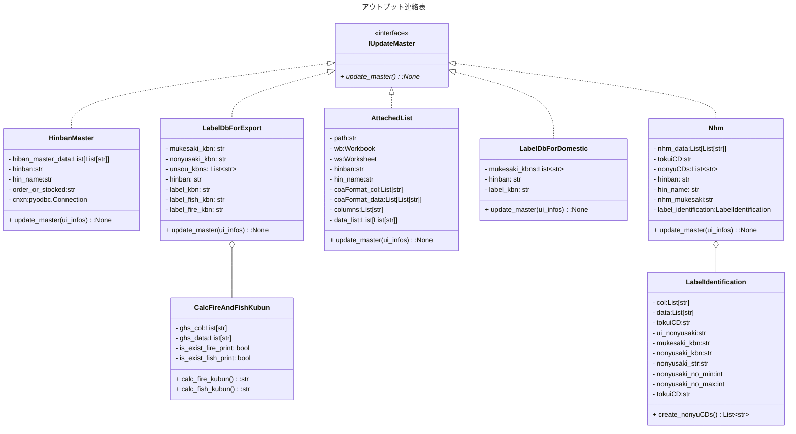

# Output Notification (アウトプット連絡表)

## 魚マーク表示
| 環境有害性 ピクトグラム | ship or air | 容器       | LabelDb表示  |
| :---:                      | :---:       | :---:      | :---:        |
| ◯                         | ship        | 魚印刷あり | F            |
| ◯                         | ship        | 魚印刷なし | ◯           |
| ◯                         | air         | 全て       | 空白         |
| X                          | ship, air   | 全て       | 空白         |

## ファイヤーマーク表示
| ファイヤー ピクトグラム | 国内or輸出  | 国連分類    | 容器       | LabelDb表示   |
| :---:                      | :---:       | :---:       | :---:      | :---:         |
| ◯                         | 輸出        | クラス3     | 炎印刷あり | 空白          |
| ◯                         | 輸出        | クラス3     | 炎印刷なし |  ◯           | 
| ◯                         | 国内        | 全クラス    | 全容器     | 空白          |
| X                          | 国内        | 全クラス    | 全容器     | 空白          |
| X                          | 輸出        | クラス3以外 | 全容器     | クラス        |

## 輸出容器の印刷状況
| 缶品番         | 品名                                  | ファイヤーマーク印刷 | 魚マーク印刷 |
| :---           | :---                                  | :---:                | :---:        |
| G-4L-UN-RYL 	 | ４LＵＮローヤル角	                 | x                    | x            |	
| G-AT-UN-PL	 | ２２ＭＢ－８Ｃ－５０	                 | x                    | x            |
| G-N-UN-WPL	 | ２０LＵＮ内面白ペール	             | o                    | x            |	
| G-UN-18L-FRYL	 | 海洋汚染　魚マーク18Ｌ UNローヤル缶	 | o                    | o            |
| G-UN-18L-HV	 | 18L UNハイブリッド 	                 | x                    | x            |	
| G-UN-18L-RYL	 | スーパー18L ＴＦ４０ＵＮ炎マーク	     | o                    | x            |	
| G-UN-6L-POL	 | 6Lポリ角KN-446グレー		             | x                    | x            |
| G-UN-N-18L-RYL | スーパー18L ＴＦ内面４０ＵＮ炎マーク  | o                    | x            |
| G-UN-PL	     | ＰＥ２０ＬＵＮＲＩ                    | o                    | x            |
| G-UN-PL-B	     | ２０ＬＵＮＲＩ(青)                    | o                    | x            |

## アウトプット追加修正

|  関連                         | 場所       | カラム名またはファイル名 | update |
| :---:                         | :---       | :---                     | :---   |
| 受注Check(休日表)             | effitA 稼働日カレンダ 東洋=工場:@@@@@  運送屋=工場:@0001,部門:DUMMY | MCALEN.CalFlg: "1" (休日) | 1回/年 |
| 受注Check(リードタイム)       | effitA 発送先別運送距離マスタ | MDESTN_U2002.DesLeadTime(int) | 得意先増えた時 |
| **受注Check(向け先、製品)**   | \\192.168.1.247\共有\受注check\master | **n&h&m_modify.xlsx** | **輸出の新製品ができた時** |
| **出荷Robot(受注見込み)**     | effitA 品番マスタ.ユーザ個別項目.受注見込区分 2:見込製品, 1:受注製品 | **品番マスター** MHINCD.HinFree18(str) "2","1" | **新製品ができた時** |
| **出荷Robot(仕入製品重量)**   | effitA 品番マスタ.ユーザ個別項目.仕入製品重量(kg) | **品番マスター** MHINCD.HinFree19(str) "16.5" |**仕入製品が増えた時** |
| 出荷Robot(次回請求しない)     | effitA 得意先マスタ.売上日基準請求区分=1:しない | MTOKUI.TokFree3(str) "1" | 次回請求しない得意先ができた時 |
| **出荷Robot(成,指)**          | \\192.168.1.247\共有\営業課フォルダ\櫻田\☆☆☆\売上処理(水野課長用) | **出荷時添付リスト.xlsx** | **新製品ができた時(国内)** |
| 出荷Robot(add)                | effit 受注入力 | RJYUCD.RjcFree1(str) |受注入力時 |
| 受注入力(工場コード)          | effitA 受注入力| RJYUCD.RjcJcKojCD(str)"@0002"| 受注入力時 |
| 運賃計算(運送対応表)          | effitA 発送先別運送距離マスタ 輸出向け先= "y":1, "":0 中継回数=1,2,3 行く行かない=0:行く, 1:行かない | MDESTN_U2002.DesIsExport(int)"y"=1,""=0  MDSDST_U2002.DsdRelayCount(int) MDSDST_U2002.DsdDisabled(int)0:行く,1:行かない | 得意先増えた時 |
| 運賃計算(以下,未満)           | effitA 相手先名称マスタ 相手先区分=A 相手先コード1=U0007 重量閾値判定区分=1:未満,空白:以下 | MAITEM.AitFree1(str)"1","" MAITEM.AitFree3(str)"1","" | 運送業者が増えた時 |
| **Labe_db**                   | Tssシステム | **ファイヤー 魚** | **新製品ができた時** |
| ラベル識別コード              | Tssシステム | ラベル識別コード 納入先担当 | 納入先が増えた時 |

## 設計
1. userの入力
    - 国内製品
        - 受注製品 or 見込み製品(ラジオボタン)
        - 成績書の有無(チェックボックス)
        - 得意先コード
        - 納入先コード
        - 成績書フォーマット(一般品、小糸、スタンレー共通....)
    - 輸出製品
        - 受注製品 or 見込み製品(ラジオボタン)
        - 向け先(本社、大阪、製造、豊通、長瀬....)
        - 納入先 (UK小糸、タイ美光、広州小糸.....)
        - 製品ラベル (日本、英語、中国、台湾、ベトナム語.....)
1. ui_infos
    - 国内製品
        - 区分: 受注製品
        - 品番: S6-SV3800L-U
        - 向け先: None
        - 納入先: None
        - 製品ラベル: 日本
        - 成績書必要: True
        - 得意先コード: T0015
        - 納入先コード: H111 -> 松沢
        - Format: 一般品
    - 輸出製品
        - 区分: 受注製品
        - 品番: S99-SV3800A-U-EX
        - 向け先: 豊通
        - 納入先: ﾀｲｽﾀﾝﾚｰ
        - 製品ラベル: 英語
        - 成績書必要: False
        - 輸出用缶: G-UN-18L-RYL

1. データ登録先
    - n&h&m_modify.xlsx
        - tokuiCD, nonyuCD(GZK01~GZK07), hinban, hinName, mksk(n&h&m特有データ)
    - 品番マスター
        - HinHinCD, HinFree18(受注:"1", 見込:"2"), HinNam
        - HinFree19(仕入製品重量 : "16.5")
    - 出荷時添付リスト.xlsx
        - tokuiCD, nonyuCD, tokuiName, hinban, hinName, 発行部署, format, 宛名, 備考)
    - label_db
        - TM_LBL_DB LBL_DB_ID, MKSK_KBN, NNSK_KBN, UNSOU_KBN, ITEM_ID, ITEM_LBL_KBN, FiRE_CHK_KBN, SAKANA_CHK_KBN, DEL_FLG <> "1")

1. 必要なデータ
    - TM_UNITY
        - MST_CD=MKSK_KBN, DTL_CD, DTL_NM(向先名), BIKOU   -> {"豊通":"04", "長瀬":"05",...}, {"04":"T0210", "05":"T2880",...}
        - MST_CD=NNSK_KBN, DTL_CD, DTL_NM(納入先名) -> {"-":"01", "UK小糸":"02", "タイ美光":"03", "広州小糸":"04"...}
        - MST_CD=UNSOU_KBN, DTL_CD, DTL_NM -> {"01":"船", "02":"エア"}
        - MST_CD=ITEM_LBL_KBN, DTL_CD, DTL_NM -> {"日本":"01", "日大中小":"02", "中国":"03", "英語":"04", "台湾":"05",... }
        - MST_CD=LBL_SAKANA_KBN, DTL_CD, DTL_NM -> {"◯":"01", "F":"02"}
        - MST_CD=LBL_FIRE_KBN, DTL_CD, DTL_NM -> {"ｸﾗｽ9":"01", "ｸﾗｽ6.1":"02", "ｸﾗｽ4.1:"03", "◯":"04"}

    - n&h&m_modify.xlsx登録用
        - ラベル識別一覧 (TM_LBL_SB) 
            - MKSK_KBN, NNSK_KBN, NNSK_STR, NNSK_NO_MIN, NNSK_NO_MAX WHERE MKSK_KBN="04" AND NNSK_KBN="03"  -> {"T0210":["THB01", "THB02"]}
    - 品番マスター登録用
        - MHINCD
            - HinFree18(受注:"1", 見込:"2"), HinHinName
    - 出荷時添付リスト.xlsx登録用
        - \Guest\向先_ｼｰﾄ表.xlsx
            - 向先_ｼｰﾄ表.向先列と一致するformatから宛名情報を取り出す
        - tokuiCD, nonyuCD, tokuiName, hinban, hinName, 発行部署, format, 宛名, 備考)
    - label_db登録用
        - TF_GHS 
            - YS_CI_KOKUREN_BUNRUI(ｸﾗｽ3), YS_CI_YOKI_HONO(◯), YS_CI_YOKI_KANKYO_YUGAI(◯)
        - 国内製品の場合
            - 本社、大阪を登録する
                - 向先、品番、製品ラベル（日本）
        - 輸出製品の場合 ｊ
            - 船、エアを登録する
                - 向先、納入先、輸送方法、品番、製品ラベル、ファイヤー、魚
1. 手順
    1. アウトプット連絡表から、必要な情報をui画面で入力する。uiで入力した情報をui_infosとする。
    1. 品番マスターに品番とHinFree18にデータがあるかを調べる。
        1. 品番マスターに品番登録されていなかったら処理を中止する。
        1. HinbanMasterのインスタンスを作成する。
        1. 品番とHinFree18のデータがui_infosの受注、見込みと一致したらスルー。
        1. 無い、または一致しない場合は、品番マスターに入力する。
    1. n&h&m_modify.xlsxに品番のデータがあるかを調べる。
        1. 国内製品の場合はスルー。
        1. ラベル識別一覧(TM_LBL_SB)のデータを取得する。
        1. LabelIdentificationのインスタンスを作成する。
        1. Dict[str,List[str]]に変換する。{"T0210":["THB01", "THB02"],....}
        1. Nhmのインスタンスを作成する。
        1. n&h&m_modify.xlsxのT0210_THB01_hinban, T0210_THB02_hinban があるか調査。 
        1. 全てあればスルー。
        1. なければ、tokuiCD, nonyuCD(GZK01~GZK07), hinban, hinName, mksk(n&h&m特有データ)を入力する。insert
        1. 一致していないレコードはUpdate
        1. 向け先に関しては、前例がある場合は前例を入力。無い場合は'GZK_納入先'を入力。
            1. GZK01からアルファベットと数字を分けて、アルファベットを取得する。
    1. 出荷時添付リスト.xlsxに必要な情報があるかを調べる。
        1. 輸出製品の場合はスルー。
        1. 国内製品でも成績書が不要の場合はスルー。
        1. ui_infosのtokuiCD,nonyuCD,hinbanが一致したらcoaFormat, 発行部署を更新する。
        1. 無い、または一致しない場合は、出荷時添付リスト.xlsxに新たに追加する。
    1. label_dbに既にデータがあるかを調べる。
        1. 国内製品の場合。
            1. (本社_大阪)、品番が一致するデータがあるか？
                1. あっても、、**データの更新は行わない。(ラベルは絶対に日本語であり、変わらないため)**
                2. 無ければ**本社、大阪の両方を登録する。**
        1. 輸出製品の場合。
            1. 向け先、納入先、製品ラベル、品番が一致するデータがあるか？
                1. あったら、**データを上書きする。~UPDATE~**
                2. 無ければ、**船、エアの両方を登録する。~INSERT~**
            1. label_dbへの登録用データ
                1. ghs_dbからデータ取得する。YS_CI_KOKUREN_BUNRUI(ｸﾗｽ3), YS_CI_YOKI_HONO(◯), YS_CI_YOKI_KANKYO_YUGAI(◯)
                1. FIRE_CHK_KBNを求める。
                    1. YS_CI_YOKI_HONOと、容器のファイヤー印刷の有無から"01"~"04"をもとめる。ｸﾗｽ3の場合はNULL。
                        1. ghs_dbから炎マークが必要か？
                        1. 不要でクラス３以外ならクラスを表示                    
                        1. 必要なら、容器に炎印刷してあるか？
                        1. 炎印刷無しなら"◯"
                        1. 炎印刷ありで、国連分類がクラス３ならNull
                        1. 炎印刷ありで、国連分類がクラス３以外なら、クラスを表示
                1. SAKANA_CHK_KBNを求める。
                    1. YS_CI_YOKI_KANKYO_YUGAIと、容器の魚印刷の有無から"01"~"02"をもとめる。◯、F以外はNULL。
                        1. ghs_dbから魚マークが必要か？
                        1. 不要ならNull
                        1. 必要でもairなら、Null
                        1. 必要かつshipで、容器に魚印刷してあるか？
                        1. 魚印刷無しなら"◯"
                        1. 魚印刷ありなら"F"

